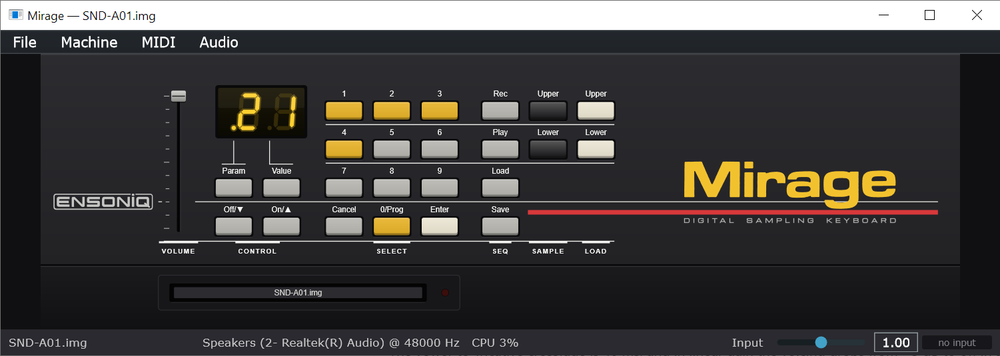

# Ensoniq Mirage Reborn

A cycle-level emulator of the Ensoniq Mirage DSK-8 sampler that runs the
original boot ROM and the original OS from the original disk images (Triton's
Soundprocess disks included). It comes as a standalone app and as a VST3
plugin.

It emulates the hardware: the 6809 CPU, the WD1772 floppy controller, the DOC
5503 sound chip, the VIA, the ACIA (MIDI), the voice filters and the analog
input stage. The Mirage's own software does everything else, as on a real unit:
play it over MIDI, edit sounds from the front panel, save them to disk, format
blank disks, import WAV files into wave RAM, and sample from the computer's
audio input.

Disk images for use with this emulator can be grabbed here:
[Ensoniq Mirage disks and manuals](https://github.com/rommix0/mirage_disk_and_manuals).

This is an early release, and a program created with the assistance of Claude.
If you notice anything off, please raise an issue. Pull requests are also
welcome.

| Part               | What it is                                                                                                |
| ------------------ | --------------------------------------------------------------------------------------------------------- |
| `engine/`          | `mirage_engine`: the chips and the machine, JUCE-free and deterministic, with exact snapshots             |
| `host/`            | `mirage_host`: real-time host (`RealtimeHost`), disk sessions, MIDI input feeding; JUCE-free              |
| `app/`             | the JUCE 8 standalone, `Mirage.exe`, with a replica front panel ([`docs/app.md`](docs/app.md))            |
| `plugin/`          | the JUCE 8 VST3 plugin, `Mirage.vst3`, the same machine inside a DAW ([`docs/plugin.md`](docs/plugin.md)) |
| `tools/mirage_cli` | headless runs, disassembly, WAV rendering, scripted panel keys                                            |
| `tests/`           | Catch2 unit and end-to-end tests (`ctest`)                                                                |
| `docs/`            | the design specs, the plans, the hardware notes and the guides                                            |

## Running a release

Download the latest `Mirage-<version>-win64.zip` from
[Releases](https://github.com/rommix0/mirage_reborn/releases), unzip it and
start `Mirage.exe`; nothing needs installing. It finds the boot ROM
(`mirage.bin`) next to the exe. *File → Open Disk Image...* a Mirage disk (for
example `SND-A01.img` from the Factory Library) and it boots from it, then play
it from a MIDI keyboard chosen in *MIDI*. To boot another disk later: *Open*,
then *Machine → Reset*. `Mirage guide.md` in the zip is the full guide.

For the plugin, copy the `Mirage.vst3` folder and `mirage.bin` side by side
into `C:\Program Files\Common Files\VST3` (or add the unzipped folder to your
DAW's VST3 paths). `Mirage plugin guide.md` is its guide.

## Building and testing

You need Visual Studio 2019 (MSVC x64), CMake 3.20+ and git. Clone the disk
library next to this repo as `disks and manuals`, where the build and the tests
look for it by default:

```
git clone https://github.com/rommix0/mirage_reborn.git
git clone https://github.com/rommix0/mirage_disk_and_manuals.git "disks and manuals"
cd mirage_reborn
```

Then, from the repo root:

```
cmake -S . -B build -G "Visual Studio 16 2019" -A x64
cmake --build build --config Debug --parallel
ctest --test-dir build -C Debug --parallel 8 --output-on-failure
```

The first configure fetches Catch2 and JUCE 8.0.4 from git, and the first build
takes several minutes. `-DMIRAGE_BUILD_APP=OFF` skips the app and the plugin.
From Git Bash use `--parallel`, not `-- /m`.

**Build Release for live play**; the Debug build is unoptimised and may glitch:

```
cmake --build build --config Release --target MirageApp MiragePlugin_VST3 mirage_cli --parallel
```

| Target              | Output                                                         |
| ------------------- | -------------------------------------------------------------- |
| `MirageApp`         | `build/app/MirageApp_artefacts/Release/Mirage.exe`             |
| `MiragePlugin_VST3` | `build/plugin/MiragePlugin_artefacts/Release/VST3/Mirage.vst3` |
| `mirage_cli`        | `build/Release/mirage_cli.exe`                                 |

(`MiragePlugin` alone builds only the plugin's shared-code library, not the
`.vst3`.)

### The boot ROM and the disk library

Two CMake cache variables locate them:

- `MIRAGE_ROM`, the 4096-byte boot ROM, defaults to `mirage.bin` in the repo
  root. It is the default `--rom` of `mirage_cli`, the app's and the plugin's
  fallback ROM, and the ROM every test boots.
- `MIRAGE_ASSET_ROOT`, the disk library, defaults to `../disks and manuals`.
  The tests use these files under it: `Factory Library/IMG/SND-A01.img`,
  `SND-A02.img`, `SND-A04.img`; `EnsoniqOS/os32`, `masos`, `resmos32.s`,
  `fmt2`; `MetascapeMetaSounds/mp1.edm`;
  `Soundprocess/Soundprocess OS/Soundprocess OS.img`;
  `Soundprocess/Soundprocess Sound Packs/*.img`; `Soundprocess/TritonSoundprocess/`
  (`SP1.EDM`-`SP6.EDM`, `SoundProcess_Vol1.edm`-`Vol7.edm`, `SNDPROCS.EDM`,
  `Triton - Soundprocess OS.edm`); and `DaDash Collection/M_10.EDM`-`M_12.EDM`.

Override either with `-DMIRAGE_ROM=<file>` / `-DMIRAGE_ASSET_ROOT=<path>`; an
existing build directory keeps its cached values until you pass new ones. Tests
that need a missing asset skip, so check the skip count, not only the pass
count (`ctest` prints them as "Not Run" or "Skipped").

## The standalone app (`app/`)

A replica front panel, menus, audio and MIDI devices, disk open and save, New
Blank Disk, Import WAV, and sampling from an audio input. It opens raw
450,560-byte images and Giebler `.edm` files (by content) and saves in the
format a disk was read in. The app keeps the real machine's timing: disks load
at floppy speed and the boot filter-calibration tones are heard. The full
guide, with the menus, shortcuts, threading model, decisions, the acceptance
checklists and the known limitations, is [`docs/app.md`](docs/app.md).

On start it loads the boot ROM from the saved path, then from `mirage.bin` next
to `Mirage.exe`, then from `MIRAGE_ROM`, and otherwise asks for it (a 4096-byte
file; a ROM with a different SHA-1 is allowed but warned about). Settings are
kept in `%APPDATA%\MirageEmulator\MirageEmulator.settings`.
`Mirage.exe --panel-png out.png` renders the front panel to a PNG and exits;
`Mirage.exe --import-dialog-png in.wav out.png` does the same for the Import WAV
dialog.

## The VST3 plugin (`plugin/`)

`Mirage.vst3` is the same machine as a VST3 instrument (Windows x64). It mutes
the boot calibration tones and makes disk loads near-instant; the DAW project
stores the whole machine. Copy it to `C:\Program Files\Common Files\VST3` or
add its folder to your DAW's VST3 paths. It takes the first boot ROM it finds:
the one chosen in the plugin (*Choose ROM*), `mirage.bin` next to
`Mirage.vst3`, the app's saved ROM path, then the build's `MIRAGE_ROM`;
otherwise it asks. Guide (with the `MIRAGE_PLUGIN_ROM` test override):
[`docs/plugin.md`](docs/plugin.md).

## The command-line tool (`mirage_cli`)

`mirage_cli run` boots the machine headless and scripts it: `--disk`, `--note`,
`--key` (front-panel presses), `--midi-hex`, `--import`, `--audio-in`, `--wav`,
`--save-disk`, `--snapshot-in`/`--snapshot-out` and `--trace`.
`mirage_cli disasm` is a linear 6809 disassembler. Run either with no arguments
for the full usage. The examples below run from the repo root with
`build/Release` on `PATH`.

The OS needs about 14.6 s of emulated time after power-on to load a factory
disk's first sound, so a note fired earlier plays nothing; start notes at 16 s
or later. Boot timing is in `docs/hardware/boot-rom.md` sections 13.5 and 13.6.

### Rendering a note to a WAV

```
mirage_cli run --disk "../disks and manuals/Factory Library/IMG/SND-A04.img" --note 48:100@16:3 --seconds 20 --wav a04.wav
```

### Saving the disk from a headless run

`--save-disk out.img` writes the disk in the drive (a 450,560-byte raw image)
at the end of the run, for example after the OS has saved a sound from `--key`
presses:

```
mirage_cli run --disk "../disks and manuals/Factory Library/IMG/SND-A01.img" --key Param@16 --key K1@17 --key K1@18 --key K1@19 --key Enter@20 --seconds 30 --save-disk edited.img
```

It exits 1 if there is no disk, a track is unformatted or the file cannot be
written. `--disk` also reads a Giebler `.edm` file (detected by content); the
disk file formats are in `docs/hardware/fdc.md`.

### Importing a WAV into wave RAM

```
mirage_cli run --disk "../disks and manuals/Factory Library/IMG/SND-A01.img" --import "sine.wav@15,rate=29412,half=lower,page=0" --note 48:100@16:2 --seconds 19 --wav out.wav
```

`--import "FILE@T[,rate=R][,start=S][,end=E][,half=lower|upper][,page=P][,normalize=0|1]"`
converts the file and writes it into wave RAM at T seconds of emulated time.
The drive must be idle (SND-A01 loads until about 14.6 s); the OS plays the
imported bytes through whatever wavesample start, end and tuning its sound
already has. See `docs/app.md` ("WAV import") for the halves and the pitch
hint.

### Sampling from the audio input jack

```
mirage_cli run --disk "../disks and manuals/Factory Library/IMG/SND-A01.img" --audio-in "sine.wav@15,gain=0.08,loop=1" --key SampleLower@16 --key Enter@19 --note 52:100@23:0.5 --seconds 24 --wav sampled.wav
```

`--audio-in "FILE@T[,gain=G][,loop=0|1]"` plays a WAV file into the emulated
input jack from T seconds of emulated time, at its own rate (resampled to
`--rate`), times gain G (default 1), repeating with `loop=1`. Repeat the option
to change the input later; a later entry replaces the earlier from its T. The
example boots SND-A01, feeds a 440 Hz sine, and the OS samples it into the
lower half (Sample Lower, then Enter once the level-detect display is up); the
note at 23 s plays it back. The mic input (parameter 75 off, the default) is 11
times hotter than line and clips a full-scale sine, hence `gain=0.08`. How the
OS samples is in `docs/hardware/filters.md` section 3.3.

## Making a release zip

Bump `VERSION` in `app/CMakeLists.txt` and `plugin/CMakeLists.txt` (both
targets) and commit. Then build from a clean clone of `main` with the C++
runtime linked in, so the binaries run on a PC without the Visual C++
redistributable, and with the asset root pointing at the real disk library
(the clone's own default would be under `build-dist/`; it is where the file
choosers start). `dist/` and `build-dist/` are git-ignored. From the repo root
in Git Bash:

```
V=0.3.0
git clone . build-dist/src
cmake -S build-dist/src -B build-dist/out -G "Visual Studio 16 2019" -A x64 -DCMAKE_MSVC_RUNTIME_LIBRARY=MultiThreaded "-DMIRAGE_ASSET_ROOT=$(cd .. && pwd -W)/disks and manuals" "-DMIRAGE_ROM=$(pwd -W)/mirage.bin"
cmake --build build-dist/out --config Release --target MirageApp MiragePlugin_VST3 mirage_cli --parallel
mkdir -p dist/Mirage-$V-win64 && cd dist/Mirage-$V-win64
cp ../../build-dist/out/app/MirageApp_artefacts/Release/Mirage.exe ../../build-dist/out/Release/mirage_cli.exe .
cp -r ../../build-dist/out/plugin/MiragePlugin_artefacts/Release/VST3/Mirage.vst3 .
cp ../../LICENSE ../../README.md ../../mirage.bin ../../app/resources/fonts/OFL-Michroma.txt .
cp ../../docs/app.md "Mirage guide.md" && cp ../../docs/plugin.md "Mirage plugin guide.md"
cd .. && powershell -Command "Compress-Archive -Path Mirage-$V-win64 -DestinationPath Mirage-$V-win64.zip -Force"
```

`LICENSE` goes with the binaries as the AGPL requires, and `OFL-Michroma.txt`
because the panel font embedded in the exe asks for its licence to travel with
it.

## Licence

Copyright (C) 2026 rommix0. Mirage Reborn is free software under the GNU Affero
General Public License, version 3 or (at your option) any later version; see
[`LICENSE`](LICENSE). Source: <https://github.com/rommix0/mirage_reborn>.

The app and the plugin use JUCE 8 under its AGPLv3 option. The plugin also
builds in the VST3 SDK that JUCE bundles, under its GPLv3 option (its
`pluginterfaces` are Steinberg VST3 Licence or GPLv3; its `base` and
`public.sdk` files are BSD-style). The engine and `mirage_host` contain no JUCE
code.

The licence does not cover the Mirage boot ROM (`mirage.bin`, Ensoniq's
firmware) or any disk image; they are not part of this project's own work.

Panel lettering: the "Mirage" wordmark is traced from a photo of a DSK panel
(`tools/fonts/trace_wordmark.py`) and the "DIGITAL SAMPLING KEYBOARD" legend
uses the Michroma font (SIL Open Font License 1.1, licence in
`app/resources/fonts/`), a free stand-in for the panel's Microgramma-style face.
Both are embedded in the exe.
